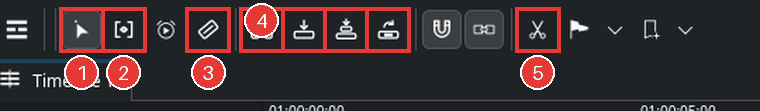

# Cut and arrange clips

This article puts clips on the timeline, plays them, and cuts, trims and deletes. It uses the Edit
page. Click in the timeline first so the keys go there.

## Put clips on the timeline

The easiest way: **drag a clip from the media pool onto the timeline**. It lands where you drop
it, with its picture on a video track and its sound on an audio track below. Hold **Ctrl** while
you drop to push the other clips aside instead of covering them.

To use only part of a clip:
1. Double-click the clip in the media pool. It opens in the source viewer.
2. Play to where the part should start and press **I** (mark in).
3. Play to where it should end and press **O** (mark out).
4. Press one of the edit buttons above the timeline (4 in the picture):

   

   - **Insert** (**F9**): puts the part at the playhead and moves the later clips to the right.
   - **Overwrite** (**F10**): puts the part at the playhead, covering what is there.
   - **Place on Top** (**F12**): puts the part on the first free track above.
   - **Replace** (**F11**): swaps the clip under the playhead for this one.

   Or press **Shift+F12** (**Edit > Append at End**) to add it after the last clip.

## Play your edit

- **Space**: play and stop.
- **L**: play forward; press it again to play faster.
- **J**: play backwards; press it again to go faster.
- **K**: stop.
- **Left** / **Right** arrow: one frame back or forward.
- **Up** / **Down** arrow: jump to the previous or next cut.
- **Home** / **End**: jump to the start or the end.

You can also click or drag in the ruler above the tracks to move the playhead.

## Cut, trim and delete

The tools on the left of the timeline tool bar (see the picture above):

- **Selection** (1, **A**): click clips to select them, drag them to move them.
- **Trim** (2, **T**): drag the edge of a clip to make it shorter or longer; the clips after it
  move along, so no gap appears.
- **Blade** (3, **B**): click a clip to cut it in two at that spot. Press **A** to go back to the
  selection tool.
- **Split Clip at Playhead** (5, **Ctrl+\\**): cuts the clips under the playhead in two (only the
  selected ones, if you selected any). Also in the **Timeline** menu.

With the selection tool, dragging the left or right edge of a clip makes it shorter or longer and
leaves a gap. **Shift+[** and **Shift+]** trim the start or the end of the clip under the playhead
to the playhead.

**To delete**, select a clip and press:
- **Backspace**: removes the clip and leaves a gap.
- **Delete**: removes the clip and closes the gap (a "ripple delete": everything after it moves
  left).

To remove a gap, click the empty space between two clips and press **Delete**.

Made a mistake? **Ctrl+Z** undoes, **Ctrl+Shift+Z** redoes.

## Keeping picture and sound together

When you trim with the Trim tool, the other tracks follow so picture and sound stay in sync, as
long as the track's **Sync Lock** button in the track header (right of the lock) is on and the
track is not locked. Making the clip longer cuts a clip that spans the edit point and opens a gap
of the same length on those tracks; making it shorter removes the same frames from them. Turn
**Sync Lock** off, or lock the track, for a track that must stay where it is. To make new tracks
start with Sync Lock off, untick **Sync Lock on new tracks** in **Preferences > Editing**; existing
tracks keep their setting. **Auto Select** only decides which tracks cuts and other edits at the
playhead reach. **Ctrl+Shift+[** and **Ctrl+Shift+]** trim to the playhead the same way.

## Where to go next

- A title and a transition: [Add a title](add-a-title.md) and [Transitions between clips](transitions.md).
- Music and fades: [Fade audio in and out, and add music](fade-audio-and-add-music.md).

Next in the path: [Colour correct a clip](colour-correct-a-clip.md), then
[Export a video](export-for-youtube.md).
