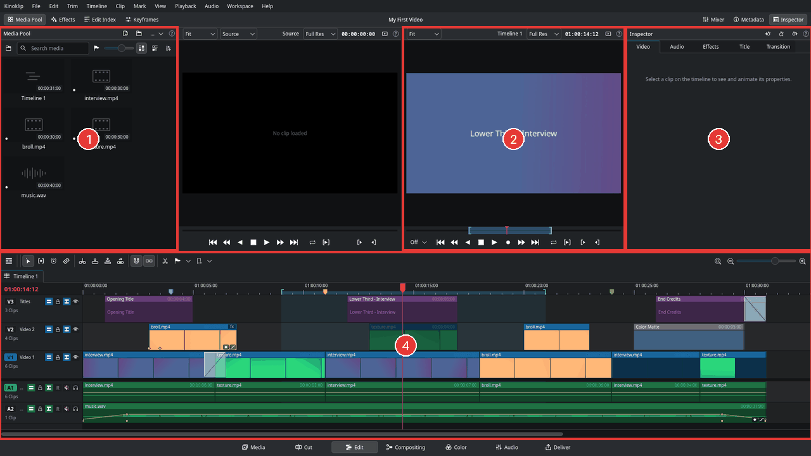

# Getting started

This article shows you around Kinoklip and makes your first project. The next ones import clips,
cut them and export the result; the whole path takes about fifteen minutes.

**Words you will meet:**
- **Clip**: one piece of video, sound or a picture.
- **Timeline**: the long strip at the bottom where your clips sit one after the other. Time runs
  from left to right.
- **Track**: one row of the timeline. Video tracks are called V1, V2, ... and audio tracks A1,
  A2, ... A clip on a higher video track covers the tracks below it.
- **Playhead**: the red line on the timeline that shows which moment you are looking at.

## The pages

Kinoklip is split into pages, one for each stage of the work. The buttons for the pages are along
the bottom of the window.

1. **Media**: look through your files and bring them into the project.
2. **Cut**: a quick, simple editor for fast rough cuts.
3. **Edit**: the main editor, where you will spend most of your time. This guide uses it.
4. **Compositing**: build the picture of one clip from nodes, for effects with several
   layers; see [Put text over a clip on the Compositing page](compositing-page.md).
5. **Color**: correct and grade the colours of your clips; see
   [Colour correct a clip](colour-correct-a-clip.md).
6. **Audio**: mix the sound: track levels, meters, equaliser and dynamics.
7. **Deliver**: export the finished video to a file.

While you drag files or clips, you do not have to let go to change page. Hold the drag over a
page button: the button lights up and fills from left to right, and after about a second the
page opens. Move away before it is full and nothing happens.

You can also switch pages with the keyboard: **Shift+2** (Media) up to **Shift+8** (Deliver);
**Shift+4** is the Edit page.

## Make a project

A project holds your timeline and the list of clips you use. When Kinoklip starts, it shows the
**Project Manager** with all your projects. You can open it again any time with
**File > Project Manager** (**Shift+1**).

1. Click **New Project**.
2. Type a name.
3. Choose the kind of project:

   1. **Single file**: everything, your clips included, is copied into one project file. Easy to
      move or back up, but it takes more disk space.
   2. **Linked**: the project only points to your clips where they already are. Smaller, but do
      not move or rename the clips afterwards.

   Lost the original of a clip in a single-file project? Right-click it in the Media Pool and
   choose **Save a Copy to Computer…**; the file is written out exactly as you imported it.
4. Click **Create**. The project opens on the Edit page.

Save your work often with **File > Save Project** (**Ctrl+S**).

## The Edit page

1. **Media pool**: the clips of your project.
2. **Viewer**: shows the picture under the playhead.
3. **Inspector**: the settings of the selected clip (size, position, volume, effects, ...).
4. **Timeline**: your edit.

The buttons at the top of the window show or hide panels: **Media Pool**, **Effects**,
**Inspector** and more.

## The welcome window

The first time you start Kinoklip, a welcome window asks a few short questions about what is
different from DaVinci Resolve: the language and colour theme, the menu layout (Resolve or
Streamlined), the keyboard, Vim mode, a few timeline habits and hardware decoding. Press **Next**
and **Finish** to keep everything as it is, or choose what you like. **Skip** changes nothing.
Every page says where the choice lives in Preferences. To see the window again, choose
**Help > Welcome**.

## Choose a menu layout

The menus at the top of the window come in two arrangements. **Resolve** (the default) has the menus of DaVinci Resolve, so a Resolve user finds everything where they expect it. **Streamlined** has shorter menus, none more than 12 lines long, grouped by task and with plain names, and one extra menu for the page you are on (Cut, Nodes or Grade, shown only on the Cut, Compositing and Color pages). Right-click menus on the timeline and in the Media Pool are shorter too, and show only what applies. The commands and their keys are the same in both.

To switch, open **Kinoklip > Preferences > UI Settings** and choose **Menu layout**. The menus change at once.

Next: [Import your clips](import-your-clips.md).

## Something went wrong?

Choose **Help > Report a Bug or Inconsistency...**. Pick whether it is a bug, something that works
differently from DaVinci Resolve, or an idea. The window shows exactly what it would add to your
report (versions and settings, nothing personal) and opens GitHub's report form in your browser,
with or without that text. Write what you did, what happened and what you expected, and submit it
there. You need a free GitHub account. Kinoklip itself never sends anything; see
[Privacy](../privacy.md). For a crash or a playback problem, also attach the log file from
**Help > Export Log File...** ([how](send-a-log-file-with-a-bug-report.md)).

Have a question, or want to show what you made? Choose **Help > Join the Community on Discord**
to open the invite to the Kinoklip server in your browser.
