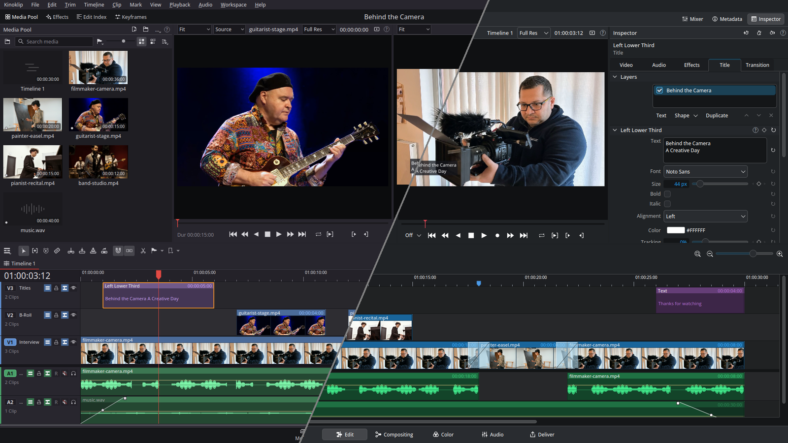
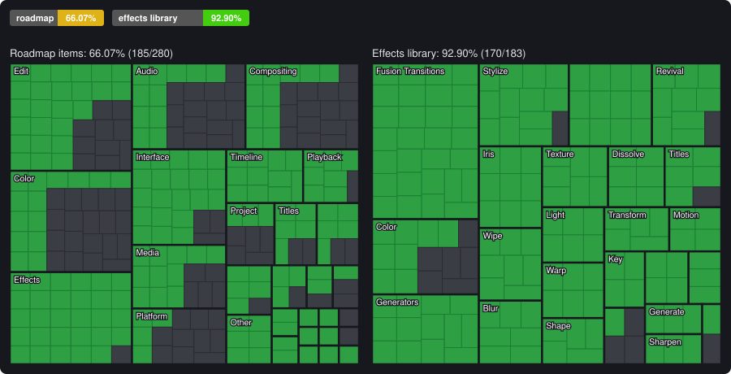
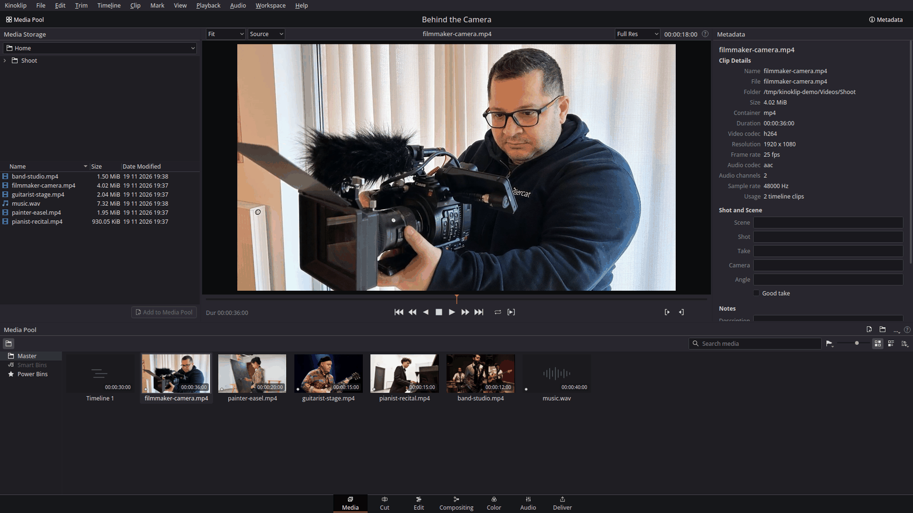
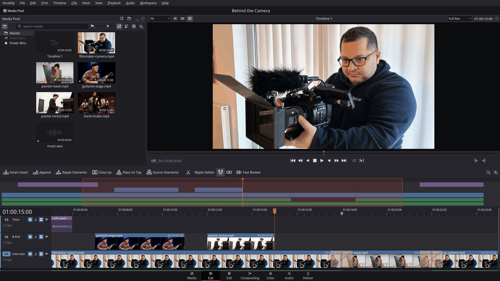
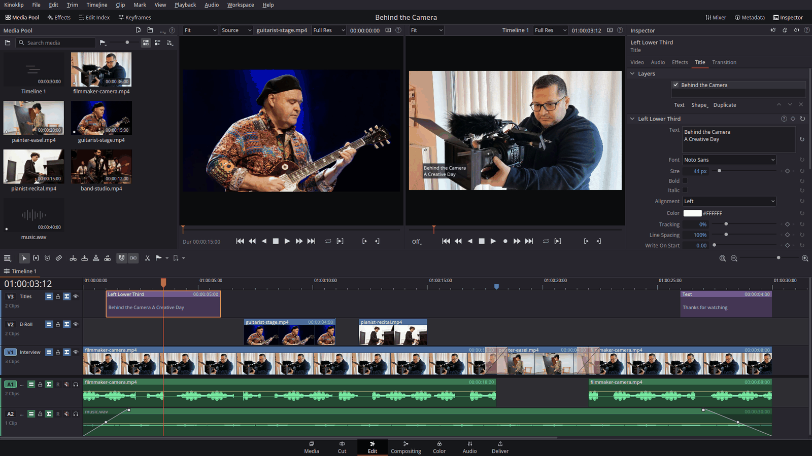
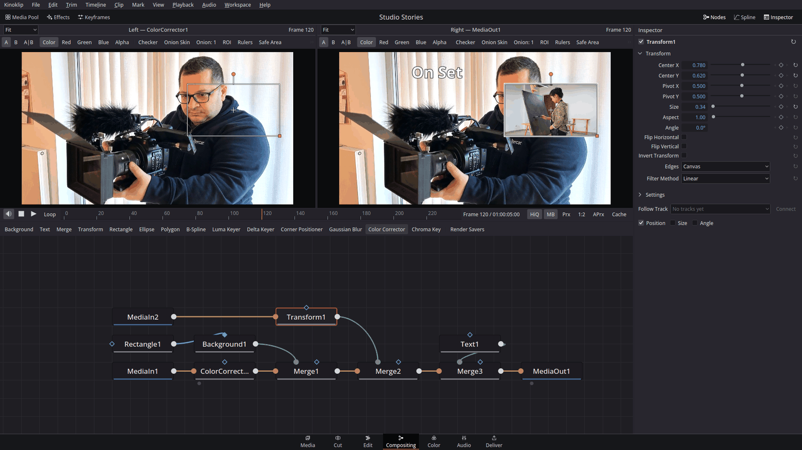
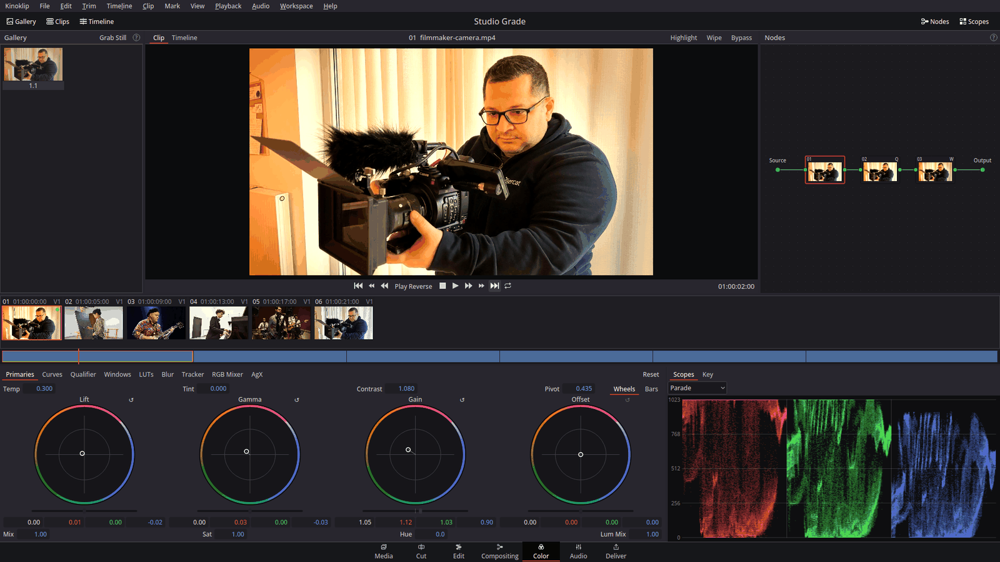
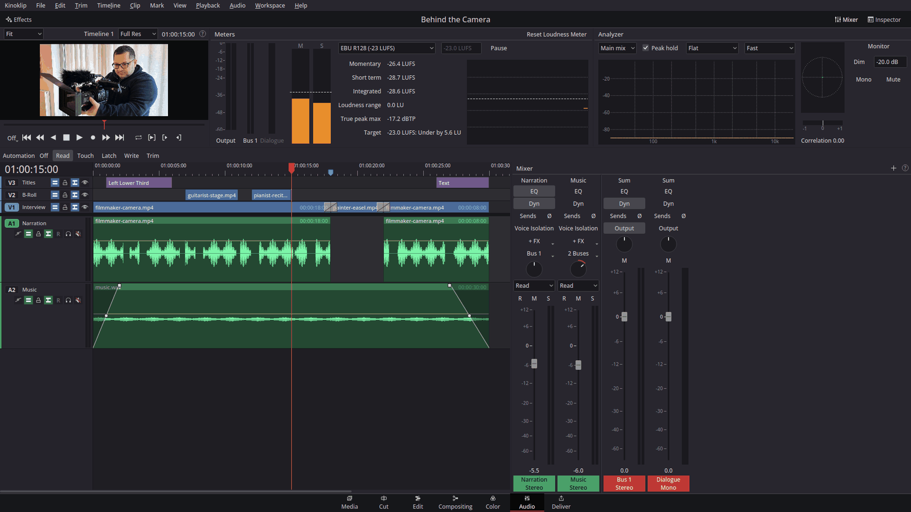
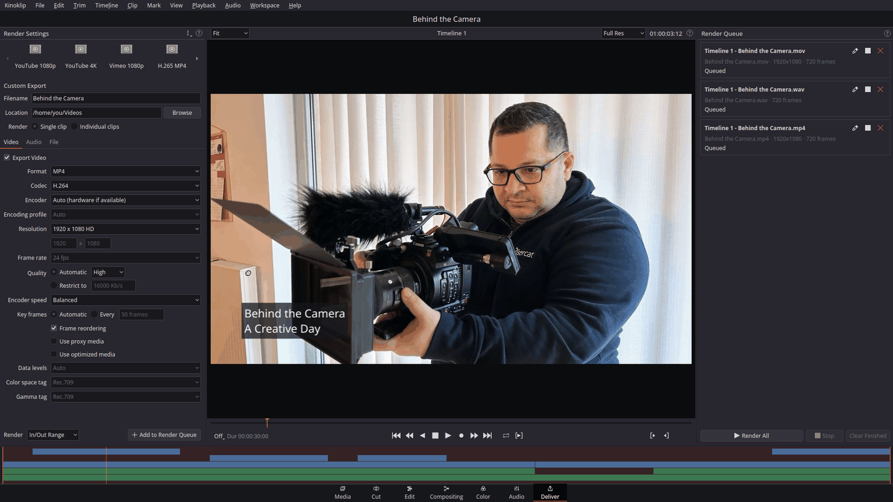
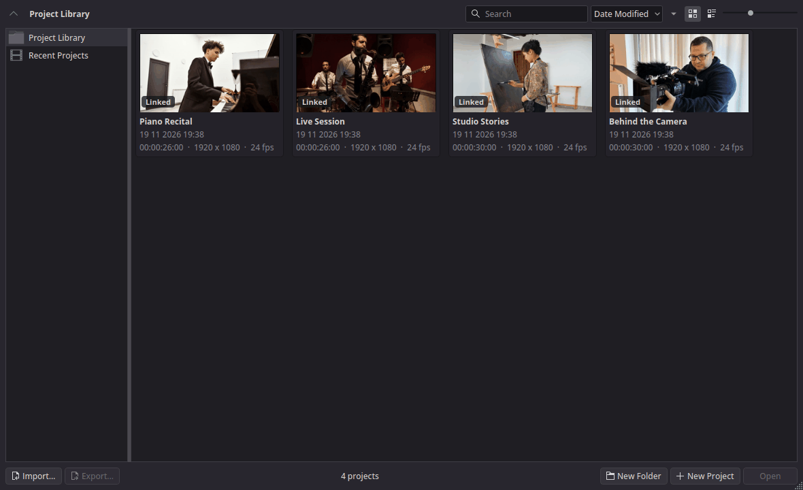

<b>A free, open-source video editor for Linux that works like DaVinci Resolve.</b>

<h3 align="center">
<a href="https://github.com/SeniorMatt/kinoklip/releases/latest">Download</a> &nbsp;·&nbsp;
<a href="docs/guide/readme.md">Guide</a> &nbsp;·&nbsp;
<a href="https://seniormatt.github.io/kinoklip/">Website</a> &nbsp;·&nbsp;
<a href="https://discord.gg/pCeHnvDn3x">Discord</a>
</h3>

Kinoklip is a non-linear video editor written from scratch in C++20 with Qt 6 and FFmpeg. Its
pages, layout, behaviour and default shortcuts follow DaVinci Resolve, with the KDE Breeze look.

 If you like Kinoklip, give it a star. It helps a lot!

## Why Kinoklip?

**On Windows or macOS:** use Resolve. Kinoklip isn't available there yet, and Resolve is the more
complete and more mature editor, made by people paid to work on it full time. Its free version is
excellent, and buying Studio supports the people who made the workflow Kinoklip copies.

**On Linux,** Resolve runs, but its support is minimal: a short list of supported distributions,
NVIDIA-first GPU support, and no H.264 or H.265 in the free version. Kinoklip gives you:

- **Smooth editing on modest hardware.** GPU decoding (VA-API) on Intel and AMD, GPU compositing,
  the next clip prepared before a cut. Keyframes, titles and animations play without lag on
  integrated graphics.
- **H.264, H.265 and AAC for free**, for import and export.
- **Microphone recording that works** through PipeWire or PulseAudio, on Wayland and X11
  ([how](docs/guide/record-a-voice-over.md)).
- **Any GPU with OpenGL 3.3**: AMD, Intel and NVIDIA, integrated graphics included.
- **The same layout and shortcuts as Resolve**, plus presets for Premiere Pro, Final Cut Pro, Vegas and others.
- **One AppImage** for every distribution, x86_64 and ARM64.
- **Free and open source** (GPL-3.0).

## Install

Download the AppImage from the [latest release](https://github.com/SeniorMatt/kinoklip/releases/latest)
and open it with [Gear Lever](https://flathub.org/apps/it.mijorus.gearlever), or make it executable
and double-click it. On Nix: `nix run github:SeniorMatt/kinoklip`.

Want to help test the next version? Get the
[dev build](docs/install.md#dev-build-help-with-testing).

More ways (NixOS, Arch Linux, building from source): [Installing Kinoklip](docs/install.md).

## Status

<!-- status:start -->

Green is done, grey is still to do. Details: [roadmap](docs/roadmap.md) and [effects library](docs/effects-library-status.md).
<!-- status:end -->

## Screenshots

Show the screenshots

<table>
<tr>
<td width="50%" valign="top"> <b>Media</b></td>
<td width="50%" valign="top"> <b>Cut</b></td>
</tr>
<tr>
<td width="50%" valign="top"> <b>Edit</b></td>
<td width="50%" valign="top"> <b>Compositing</b></td>
</tr>
<tr>
<td width="50%" valign="top"> <b>Color</b></td>
<td width="50%" valign="top"> <b>Audio</b></td>
</tr>
<tr>
<td width="50%" valign="top"> <b>Deliver</b></td>
<td width="50%" valign="top"> <b>Project Manager</b></td>
</tr>
</table>

## Documentation

- [How to use Kinoklip](docs/guide/readme.md): short how-to guides
- [Resolve keymap](docs/keymap-resolve-windows.md) and [keyboard presets](docs/keymaps/readme.md) (Vegas Pro, Premiere Pro, Final Cut Pro, Avid Media Composer, Kdenlive, Shotcut), and [Vim mode](docs/guide/edit-with-vim-keys.md)
- [Menu reference](docs/menu-reference.md): every menu entry and panel
- [Release notes](docs/releases/)
- [Privacy](docs/privacy.md): Kinoklip collects and sends nothing about you

For developers: [building](docs/building.md), [contributing](docs/contributing.md) and [all documents](docs/readme.md).

## Community and support

- Questions, ideas and your edits: the [Discord server](https://discord.gg/pCeHnvDn3x).
- Bugs: [GitHub issues](https://github.com/SeniorMatt/kinoklip/issues), so they don't get lost in chat.
- Support the project: [ko-fi.com/seniormatthew](https://ko-fi.com/seniormatthew), it will be much appreciated.

## License

GPL-3.0-or-later, see [license.md](license.md). The Kinoklip name, icon and logos are not under the
GPL: forks must replace them, see [logo-license.md](logo-license.md).

Kinoklip is an independent project, not affiliated with Blackmagic Design, and is written clean-room
without any Blackmagic code or assets. Trademarks, the clean-room rules, codec patents and the
warranty: [legal notes](docs/legal.md).

## AI disclosure

This project was built with AI: almost all of the code, tests and documentation were written by
AI, then checked and analysed by me, the project owner, who also directs and tests it. The icon
was drawn by hand.
**We aren't appreciating AI art here.**
